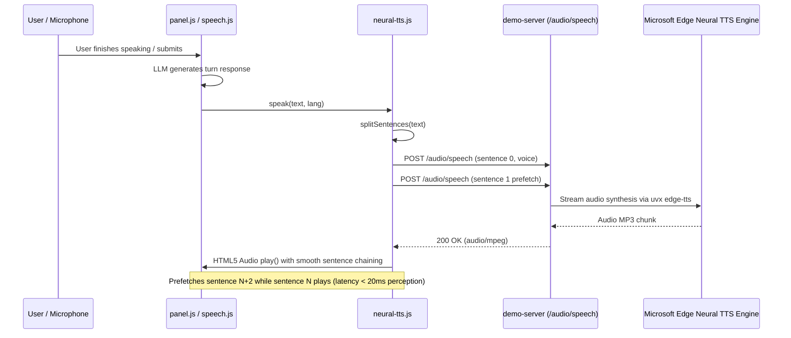

# Fluent 2.0: Edge Neural Conversational Speech Engine

## 1. Executive Summary & Problem Statement
Currently, Fluent defaults to local LM Studio inference (`http://localhost:1234/v1`) using `google/gemma-4-26b-a4b-qat`. However, `panel.js` strictly ties `createNeuralTts` to an OpenAI API key. Without an OpenAI key, speech synthesis falls back to browser `window.speechSynthesis`, which on macOS invokes legacy system formant synthesizers (*Samantha* for English, *Monica* for Spanish). This produces robotic, monotone audio that clashes with Fluent 2.0's clinical, warm, and natural conversational persona.

This specification designs an integrated, **zero-key, low-latency Neural TTS service** embedded in the local demo server and client audio engine, providing Gemini Live-grade human prosody across all 12 supported languages.

---

## 2. Voice Persona & Mapping Matrix
The neural voices are selected specifically for conversational warmth, clinical reassurance, and clear articulation:

| Language Code | Language Name | Primary Neural Voice | Tone / Persona |
| :--- | :--- | :--- | :--- |
| `es` / `es-US` / `es-ES` | Spanish | `es-US-PalomaNeural` (alt: `es-MX-DaliaNeural`) | Warm, compassionate, natural Latin-American/US cadence |
| `en` / `en-US` | English | `en-US-AvaMultilingualNeural` (alt: `en-US-JennyNeural`) | Conversational, expressive, caring, friendly |
| `hi` / `hi-IN` | Hindi | `hi-IN-SwaraNeural` | Clear, respectful, patient |
| `zh` / `zh-CN` | Mandarin | `zh-CN-XiaoxiaoNeural` | Warm, approachable |
| `fr` / `fr-FR` | French | `fr-FR-VivienneMultilingualNeural` | Clear, pleasant |
| `pt` / `pt-BR` | Portuguese | `pt-BR-ThalitaMultilingualNeural` | Friendly, conversational |
| `ar` / `ar-SA` | Arabic | `ar-SA-ZariyahNeural` | Clear, polite |
| `vi` / `vi-VN` | Vietnamese | `vi-VN-HoaiMyNeural` | Friendly, natural |
| `ko` / `ko-KR` | Korean | `ko-KR-SunHiNeural` | Gentle, polite |
| `ru` / `ru-RU` | Russian | `ru-RU-SvetlanaNeural` | Calm, helpful |
| `tl` / `fil-PH` | Tagalog | `fil-PH-BlessicaNeural` | Pleasant, natural |
| `bn` / `bn-IN` | Bengali | `bn-IN-TanishaaNeural` | Polite, friendly |

---

## 3. Architecture & Data Flow



---

## 4. Component Details

### 4.1 Server: `tools/demo-server-lib.mjs`
- Expose route `POST /audio/speech`.
- Request body:
  ```json
  {
    "input": "Hola, soy Fluent. Te ayudaré con este formulario.",
    "voice": "es-US-PalomaNeural",
    "response_format": "mp3"
  }
  ```
- Implementation:
  - Extract `input` and `voice`. If `voice` not specified, pick from language header or default to `es-US-PalomaNeural`.
  - In-memory LRU cache (`Map<string, Buffer>`) for instant zero-latency playback of common phrases.
  - Spawns `uvx edge-tts --voice <voice> --text <input> --write-media -` and pipes stdout to response with headers:
    - `Content-Type: audio/mpeg`
    - `Cache-Control: public, max-age=86400`
  - Graceful timeout (10s) and error handling returning 500 if synthesis fails.

### 4.2 Client Audio Engine: `extension/lib/neural-tts.js`
- Export `pickNeuralVoice(lang)` returning the top voice for `lang`.
- In `createNeuralTts`, support dynamic voice per utterance:
  ```javascript
  async function fetchClip(sentence, lang) {
    const v = pickNeuralVoice(lang) || voice;
    ...
  }
  ```
- Support local endpoint detection without requiring `api.openai.com` or an `sk-` key.

### 4.3 Panel Wiring: `extension/panel/panel.js`
- Update `applyVoice()`:
  - If server offers local `/audio/speech` or running in demo, enable neural voice using the local endpoint.
  - If an OpenAI key is configured, route to OpenAI TTS.
  - Otherwise fall back to browser `SpeechSynthesis`.
- Automatically update active neural voice when user changes language dropdown.

---

## 5. Failure Recovery & Graceful Degradation
- If `uvx edge-tts` is offline or network fails, `neural-tts.js` catches the error, emits `console.warn`, and instantly degrades to browser `SpeechSynthesis` without crashing the session or delaying form filling.
- Barge-in ducking remains instant: tapping `#mic` or user speech triggers `stopSpeaking()`, which immediately pauses the active HTML5 `Audio()` element and aborts pending fetch requests.
